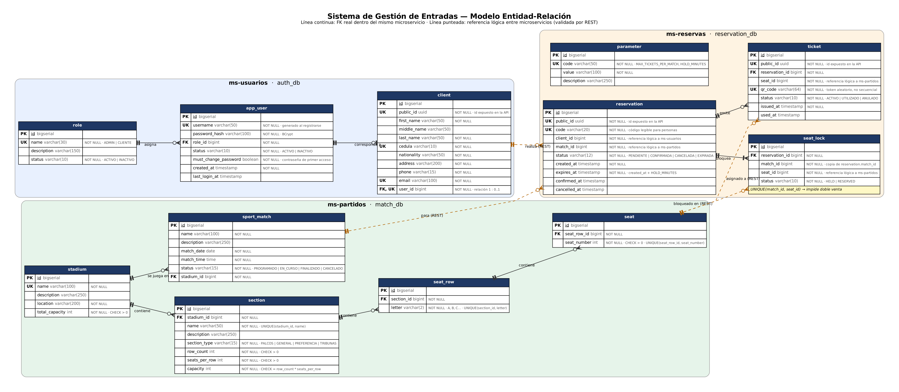
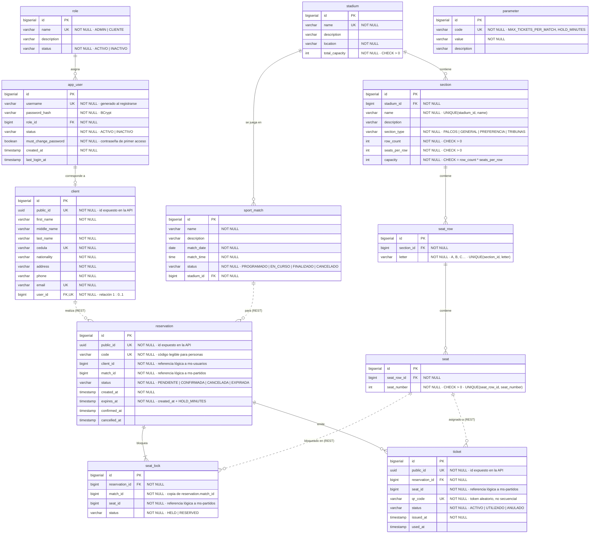

# Modelo Entidad-Relación

Sistema de Gestión de Entradas para eventos deportivos. El modelo tiene **12 tablas repartidas en 3 bases de datos**, una por microservicio, como pide el enunciado.

| Microservicio | Base de datos | Tablas |
|---|---|---|
| `ms-usuarios` | `auth_db` | `role`, `app_user`, `client` |
| `ms-partidos` | `match_db` | `stadium`, `section`, `seat_row`, `seat`, `sport_match` |
| `ms-reservas` | `reservation_db` | `parameter`, `reservation`, `seat_lock`, `ticket` |

## Diagrama

- **Línea continua:** llave foránea real, dentro de la misma base de datos.
- **Línea punteada:** referencia lógica entre microservicios. No hay FK porque las tablas viven en bases distintas; la integridad se valida por REST.

Versión en código (GitHub la dibuja automáticamente; el archivo fuente es [`modelo-er.mmd`](modelo-er.mmd)):

## Relaciones

| Relación | Cardinalidad | Participación | Implementación |
|---|---|---|---|
| role → app_user | 1 : N | Todo usuario tiene rol | `app_user.role_id` NOT NULL |
| app_user → client | 1 : 0..1 | Total del lado `client`, parcial del lado `app_user` (el admin no es cliente) | `client.user_id` NOT NULL UNIQUE |
| stadium → section | 1 : N | Toda sección pertenece a un estadio | `section.stadium_id` NOT NULL |
| section → seat_row | 1 : N | Toda fila pertenece a una sección | `seat_row.section_id` NOT NULL |
| seat_row → seat | 1 : N | Todo asiento pertenece a una fila | `seat.seat_row_id` NOT NULL |
| stadium → sport_match | 1 : N | Todo partido se juega en un estadio | `sport_match.stadium_id` NOT NULL |
| reservation → seat_lock | 1 : 1..N | Una reserva bloquea al menos un asiento | `seat_lock.reservation_id` NOT NULL |
| reservation → ticket | 1 : 0..N | Los tickets se emiten al confirmar | `ticket.reservation_id` NOT NULL |
| client → reservation | 1 : N | Lógica (otro servicio) | `reservation.client_id`, validado por REST |
| sport_match → reservation | 1 : N | Lógica (otro servicio) | `reservation.match_id`, validado por REST |
| seat → seat_lock / ticket | 1 : N | Lógica (otro servicio) | `seat_id`, validado por REST |

## Decisiones de diseño

1. **La FK va en el lado N** de cada relación 1:N. En la relación 1 : 0..1, va en el lado con participación total (`client`), porque así puede ser NOT NULL.
2. **El estado del asiento depende del partido**, no del asiento. Por eso no hay columna `status` en `seat`: el asiento A-5 puede estar vendido el sábado y libre el domingo.
3. **`seat_lock` guarda solo los asientos tomados.** Sin fila = libre; `HELD` = retenido mientras el cliente confirma; `RESERVED` = vendido. Si la retención expira o la reserva se cancela, se borra la fila; el historial queda en `reservation` y `ticket`.
4. **`UNIQUE(match_id, seat_id)` en `seat_lock` impide la doble venta** aunque dos clientes reserven el mismo asiento en el mismo segundo. La base rechaza el segundo insert y el servicio responde `409 Conflict`. El código revisa; la base de datos garantiza.
5. **`seat_lock.match_id` es una desnormalización deliberada.** El dato ya está en `reservation.match_id`, pero una restricción UNIQUE no puede abarcar dos tablas. Se copia al crear el bloqueo y nunca se modifica.
6. **Un ticket por entrada**, con `qr_code` UNIQUE y aleatorio (no secuencial, para que no se pueda adivinar ni falsificar). Cada QR es una persona, un asiento y un estado.
7. **"Administrador" es un rol, no una tabla.** Un usuario tiene un solo rol (segregación de funciones): si un administrador quiere comprar, usa una cuenta de cliente.
8. **Contraseñas con hash BCrypt**, no con cifrado reversible. `must_change_password` obliga a cambiar la contraseña de primer acceso enviada por correo.
9. **`section.capacity` tiene `CHECK (capacity = row_count * seats_per_row)`**: el enunciado pide guardar los tres valores y la restricción impide que se contradigan.
10. **Las reglas configurables viven en `parameter`** (`MAX_TICKETS_PER_MATCH = 6`, `HOLD_MINUTES`). Cambiar el límite es actualizar un registro, no el código.
11. **Identificadores en inglés y datos de negocio en español** (`PALCOS`, `PENDIENTE`, `ACTIVO`). Las tablas `app_user`, `seat_row` y `sport_match` evitan las palabras reservadas `user`, `row` y `match`.
12. **Id interno + id público.** Todas las tablas usan `id BIGINT` como PK interna: joins rápidos, índices compactos y semillas legibles. `client`, `reservation` y `ticket` agregan `public_id UUID`, el único identificador que viaja en las URLs de la API (`/api/reservations/{public_id}`). Un id secuencial en la URL permite enumerar recursos ajenos (IDOR); el UUID lo impide. El catálogo (estadios, secciones, partidos) es información pública y conserva el `id` numérico en la URL. **El UUID no reemplaza la autorización:** el servicio igual verifica que el recurso pertenezca al usuario del token.
13. **`reservation.code` es para personas, no para la API.** Un código legible como `RES-2026-000123` es adivinable; sirve para soporte y para el boleto impreso, pero no como identificador en URLs.

## Reglas que la base de datos no puede garantizar

Estas reglas se implementan en la capa *Service* de cada microservicio y deben tener casos de prueba en Apidog.

| Regla | Microservicio | Respuesta si se viola |
|---|---|---|
| Máximo de entradas por cliente y partido (`MAX_TICKETS_PER_MATCH`), sumando sus reservas no canceladas ni expiradas | ms-reservas | `422` |
| Liberar asientos `HELD` cuando `expires_at` vence (tarea programada) | ms-reservas | — |
| Solo se cancelan reservas no expiradas cuyos tickets no fueron utilizados | ms-reservas | `409` |
| El rol ADMIN no puede crear reservas | ms-reservas | `403` |
| Un cliente solo ve y cancela sus propias reservas | ms-reservas | `403` |
| La suma de capacidades de las secciones no supera `stadium.total_capacity` | ms-partidos | `422` |
| Asiento o partido inexistente al reservar | ms-reservas → ms-partidos | `404` |
| Usuario inactivo no puede iniciar sesión | ms-usuarios | `403` |

## Pendientes

- [ ] Tabla de auditoría (`audit_log`) para cubrir la "A" de auditoría de la tríada AAA.
- [ ] Llave de idempotencia en `POST /reservations` para evitar reservas duplicadas por doble clic o reintentos.
